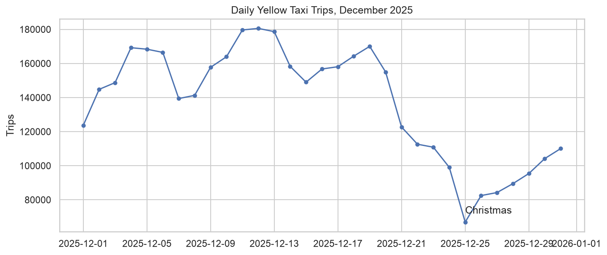
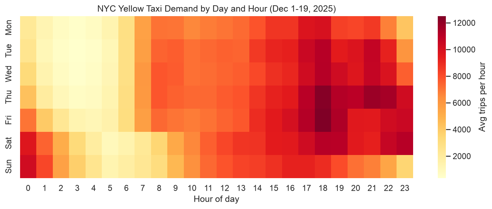
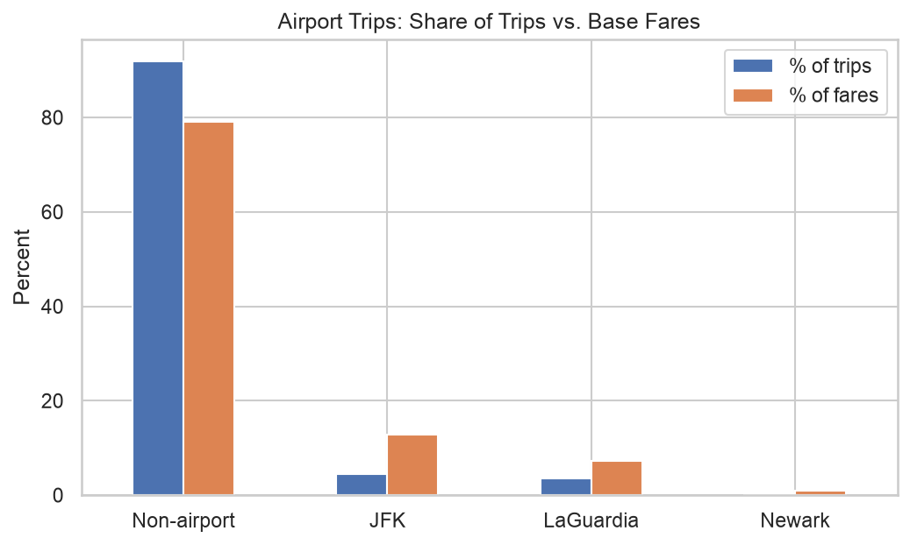
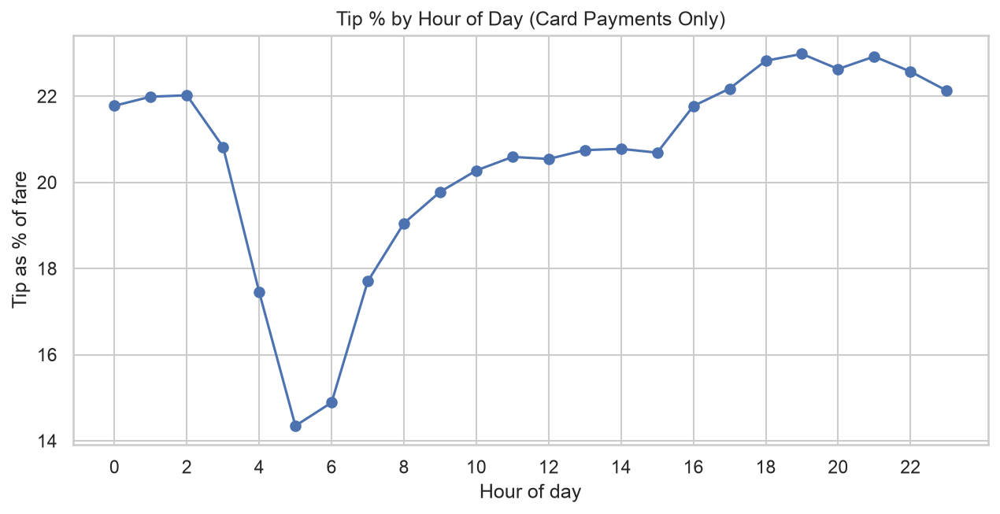
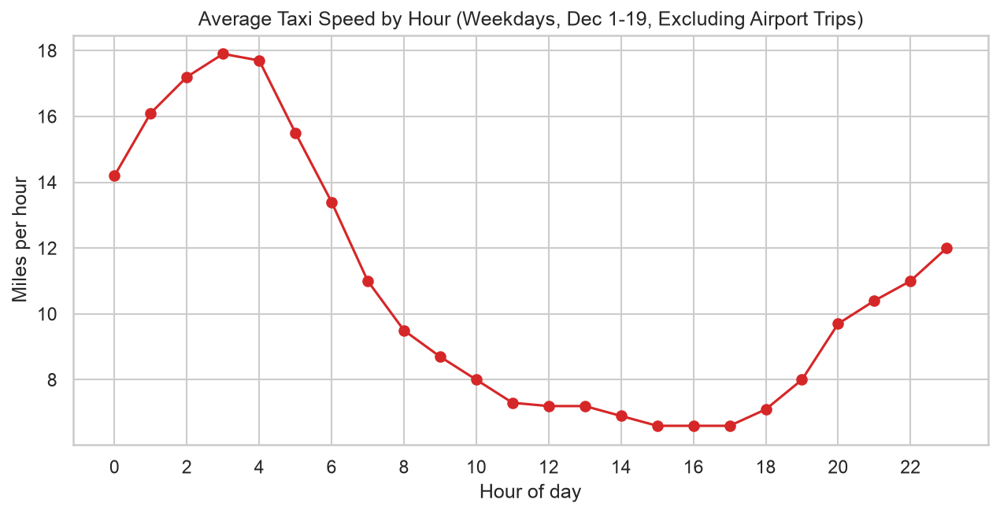

# NYC Yellow Taxi Trips: December 2025

An analysis of 4.3 million NYC yellow taxi trips during December 2025: when and where demand peaks, differences in airport trips, tipping patterns, and traffic speed by hour. Built with Python (pandas), DuckDB SQL, and matplotlib/seaborn.

**Data source:** [NYC TLC Trip Record Data](https://www.nyc.gov/site/tlc/about/tlc-trip-record-data.page) (yellow taxi December 2025, and taxi zone lookup table).

## Key findings

### 1. Demand peaks Thursday to Saturday and drops over the holidays

In the first 19 days of December, average daily trips ranged from about 138,000 on Mondays to about 173,000 on Fridays and Saturdays. Volume peaked near 180,000 trips on Dec 11-13, then fell to 66,912 on Christmas Day. Weekday rush hours stand out in the heatmap, while weekends shift toward more late-night trips.

### 2. The Upper East Side is the busiest pickup area

The top pickup zones were Upper East Side South (193,985 trips), Upper East Side North (175,974), Midtown Center (159,925), and JFK Airport (156,576). The busiest zone pair was Upper East Side South to Upper East Side North, with 29,127 trips at a $9.27 average fare.

### 3. Airport trips are about 8% of trips but about 21% of base fares

| Trip group | Share of trips | Share of base fares | Avg fare | Avg miles | Avg minutes |
|---|---|---|---|---|---|
| Non-airport | 91.9% | 79.1% | $19.36 | 2.7 | 17.0 |
| JFK | 4.5% | 12.8% | $64.49 | 15.4 | 46.6 |
| LaGuardia | 3.5% | 7.2% | $47.13 | 9.6 | 33.6 |
| Newark | 0.2% | 0.9% | $98.59 | 16.8 | 42.6 |

### 4. Tipping varies by hour and by trip type (measured with card payments only)

Tip percentage was lowest at 5 AM (14.3% of the fare) and highest around 7 PM (23.0%). By trip type, LaGuardia trips tipped the most (23.7%), then non-airport trips (21.5%), JFK (18.9%), and Newark (18.5%). The data records card tips only, so cash tips are excluded.

### 5. Afternoon traffic moves at slightly over a third of overnight speed

On weekdays (Dec 1-19 and excluding airport trips), average speed was about 17.9 mph at 3 AM and 6.6 mph between 3 and 6 PM. Speed is measured by total distance divided by total time each hour.

### 6. Flex Fare trips are longer, not much pricier per mile

Flex Fare is payment type 0 in the TLC data dictionary where the provider quotes an upfront fare. Flex Fare trips are 28% of the cleaned data. After excluding airport and zero-distance trips, they averaged a $26.99 fare and 3.60 miles, versus $16.24 and 2.31 miles for other trips. Fare per mile was $7.50 versus $7.04, so most of the fare gap comes from longer trips.

## Data cleaning

**Rows dropped** (rules overlap, so counts do not add up to the total):

- Pickup outside December: 9
- Trip longer than 3 hours: 2,160
- Fare of $0 or less: 50,716
- Distance over 100 miles: 197
- Fare over $500: 62

In total, 53,084 rows (1.2%) were dropped, leaving 4,251,922 (98.8%).

**Rows kept and flagged:** 

- `is_flex_fare`: 1,194,787
- `bad_duration`: 57,984
- `zero_distance`: 148,293

**Missing values:** the only nulls in the raw data (`passenger_count`, `RatecodeID`, `store_and_fwd_flag`, `congestion_surcharge`, `Airport_fee`) are in the rows with `payment_type` 0 (Flex Fare), about 28% of the data. Nulls were left unfilled.

3 hours, 100 miles,and $500 thresholds catch clearly implausible records.

## Limitations

- Only one month that includes the holidays, so results may not generalize to other months.
- Tip analysis covers card payments only since cash tips are not recorded and Flex Fare trips have a different payment code.

## Tools

Python, pandas, DuckDB (SQL), matplotlib, seaborn, Jupyter in VS Code.

## How to reproduce

1. Clone this repo and create a virtual environment.
2. `pip install -r requirements.txt`
3. Download `yellow_tripdata_2025-12.parquet` and `taxi_zone_lookup.csv` from the TLC link above into `data/raw/`.
4. Open the notebook in `notebooks/` and run all cells. It writes the cleaned file to `data/processed/` and the charts to `figures/`.